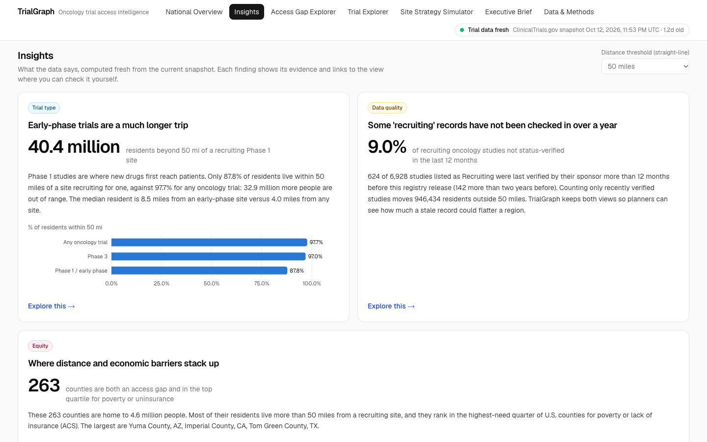
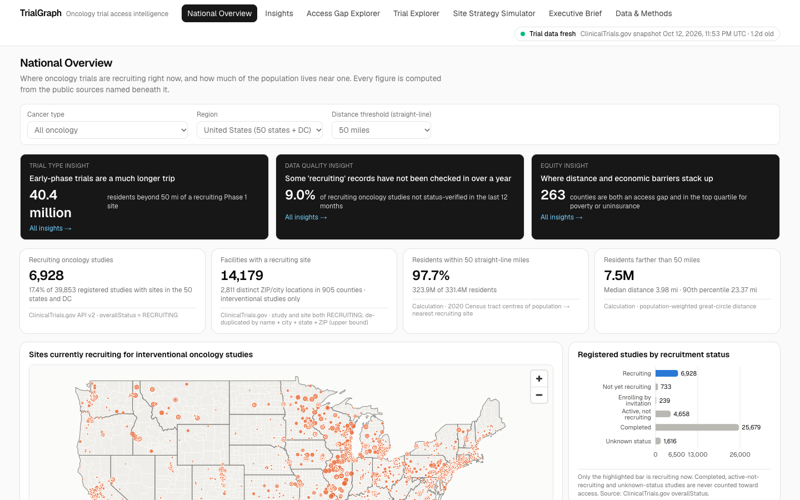
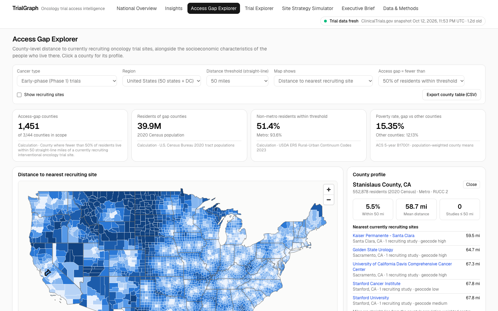
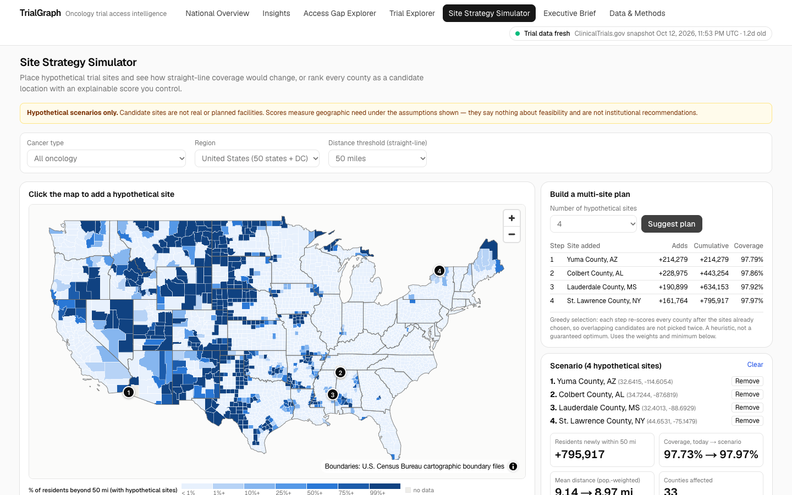
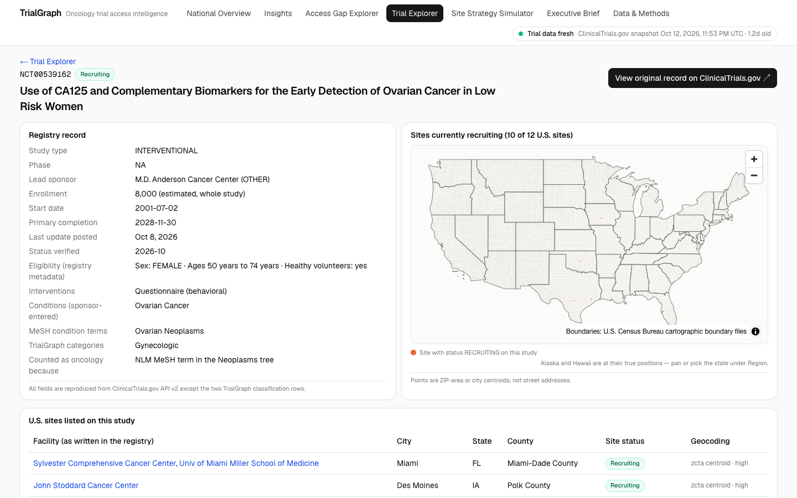
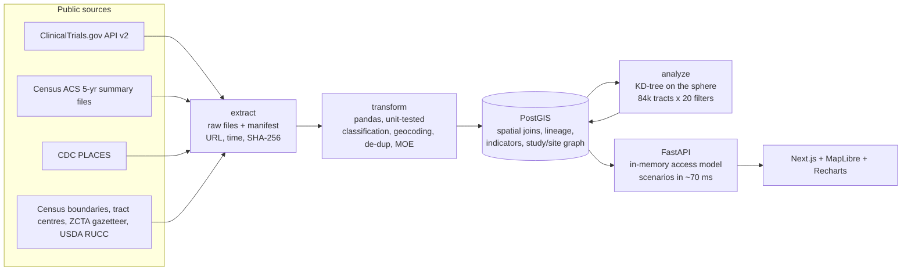

# TrialGraph

**Where can cancer patients actually reach a trial that is recruiting today, and where would a new site
matter most?**

TrialGraph is a full-stack geospatial analytics platform built on public data. It turns the
ClinicalTrials.gov registry, the U.S. Census and CDC PLACES into tract-level access measures for
recruiting oncology trials. It surfaces the gaps that matter (early-phase deserts, rural counties, places
where distance and poverty stack up) and lets planners test hypothetical sites with an explainable score
whose robustness is tested.



> Population-level planning tool. No patient data, no individual eligibility, no claim that proximity
> equals access. Hypothetical sites are labelled hypothetical everywhere.

## What the data says

Snapshot: ClinicalTrials.gov data release 2026-10-09, 50 states + DC. All distances straight-line.

| | Finding |
|---|---|
| **17%** | of 39,853 U.S. oncology studies in the registry are recruiting now. The other 83% never count toward access. |
| **97.7%** | of residents live within 50 miles of a recruiting site, but **87.6%** of non-metro residents do, against 99.4% in metros. |
| **40.4 M** | people live more than 50 miles from a recruiting **Phase 1** site, 32.9 M more than for any trial. Early-phase access is the real desert. |
| **263** | counties are both access gaps and in the top quartile for poverty or uninsurance: **4.6 M** people facing stacked barriers. |
| **9.0%** | of "recruiting" studies were not status-verified by their sponsor in the past year. TrialGraph shows coverage with and without them. |
| **9.0%** | of recruiting interventional studies exclude anyone aged 75+, the age group where cancer is most common. |
| **50%** | of recruiting study-site listings sit at the busiest 5% of sites. Only 905 of 3,144 counties host any recruiting site. |
| **26%** | of the 50-mile gap is all that ten optimally placed new sites would close. The rest calls for decentralised trial models, not more buildings. |

All of these are generated live by `GET /api/insights` from the current snapshot; none are hard-coded.
The narrative version is in [docs/CASE_STUDY.md](docs/CASE_STUDY.md).

## Product tour

| | |
|---|---|
|  **National Overview**: recruiting sites, status mix, coverage by county type, cancer type and sponsor |  **Access Gap Explorer**: county choropleths of distance or ACS/PLACES indicators, county profiles with margins of error, gap vs. non-gap comparison |
|  **Site Strategy Simulator**: click to place hypothetical sites, multi-site plan builder, weighted ranking, 500-draw sensitivity analysis |  **Trial Explorer**: every number traces back to real NCT records, their sites, and the original registry page |

There is also an **Executive Brief** (generated findings, ranked opportunities, methodology, limitations;
Markdown/CSV/PDF export), **facility profiles**, and a **Data & Methods** page (sources, hashes, freshness,
data dictionary, data-quality counters). A captioned three-minute walkthrough is at
[docs/demo/trialgraph-demo.webm](docs/demo/trialgraph-demo.webm).

## What makes it different

- **It does not count every study as recruiting.** A site contributes only when *both* the study and that
  site are `RECRUITING`; 15,137 non-recruiting site links inside "recruiting" studies are excluded. A test
  fails if a completed or unknown-status study ever adds coverage.
- **Trial-type lenses.** Coverage for early-phase, phase 3, 75+-eligible, pediatric and recently verified
  trials, computed for all 84,414 tracts, on every page, map and simulation.
- **It audits its own inputs.** It measures registry staleness, rates geocoding confidence per site
  (ClinicalTrials.gov only gives city-level points, so sites are re-located to ZIP areas and conflicts are
  flagged), de-duplicates free-text facility names conservatively, and never imputes a missing value.
- **Tract-level, not county-centroid.** Distances run from 2020 Census centres of population for 84,414
  tracts; counties are population-weighted aggregates. Results are cross-checked against PostGIS geodesic
  distance (maximum difference 0.44%).
- **Explainable, stress-tested recommendations.** A five-component score with user weights, a greedy
  multi-site planner that doesn't double-count overlapping candidates, and sensitivity analysis showing
  how rankings move under 500 seeded weightings and other distance thresholds. The honest result:
  rankings are threshold-sensitive, and the app says so.
- **Every number is traceable.** Source URL, retrieval time and SHA-256 are stored for every file; every
  KPI tile names its source; the data dictionary is generated from the live schema.

## Architecture



| Layer | Stack |
|---|---|
| Data | Python 3.12, pandas, GeoPandas, httpx, PostgreSQL + PostGIS |
| Analysis | NumPy, SciPy (cKDTree), PostGIS `ST_DWithin` / `ST_Distance` |
| API | FastAPI, SQLAlchemy, psycopg 3 |
| Web | Next.js 16, TypeScript, Tailwind 4, shadcn/ui, MapLibre GL JS, Recharts |
| Quality | pytest (unit, data validation, API), Playwright (browser), ruff, ESLint |
| Ops | Docker Compose, GitHub Actions (CI + weekly data refresh), Makefile |

More: [Architecture](docs/ARCHITECTURE.md) · [Methodology](docs/METHODOLOGY.md) ·
[Data dictionary](docs/DATA_DICTIONARY.md) · [Sources & lineage](docs/SOURCES_AND_LINEAGE.md) ·
[Case study](docs/CASE_STUDY.md) · [Demo script](docs/DEMO_SCRIPT.md) ·
[Implementation status](IMPLEMENTATION_STATUS.md)

## Run it

**Docker Compose**

```bash
docker compose up -d db
docker compose run --rm pipeline        # downloads ~1 GB of public files, builds the database
docker compose up -d api web            # http://localhost:3000 · API docs http://localhost:8000/docs
```

Set `TG_PILOT_STATES=NC,SC,VA` before the pipeline step to build a pilot geography instead of the nation.

**Without Docker** (needs Node 20+, pnpm, curl; Python 3.12 and PostGIS are installed into `.tools/` by
micromamba, nothing system-wide)

```bash
make setup       # toolchain + dependencies
make pipeline    # local PostGIS on :5433, then extract -> transform -> load -> analyze (~5 min first run)
make api         # http://localhost:8010/docs
make web         # http://localhost:3010
```

**Tests**

```bash
make test-unit   # 78 pytest tests: parsers, geodesy, scoring, lenses, insights, data validation, API
make test-e2e    # 10 Playwright tests against the running app
make lint
```

Database-backed tests skip when no database is loaded. CI runs the whole pipeline on a pilot geography
against a PostGIS service container, then every test.

## Pipeline CLI

```bash
trialgraph extract [--refresh] [--only ctgov,acs,places,geo]
trialgraph transform
trialgraph load        # idempotent full rebuild
trialgraph analyze     # tract_access + county_supply (~20 s nationally)
trialgraph all
trialgraph freshness   # age/staleness of every source (+ live registry check via the API)
trialgraph docs        # regenerate docs/DATA_DICTIONARY.md from the database
```

## Limits, stated up front

Straight-line distance, not travel time (optional OSRM hook, unverified). Site locations are ZIP-area or
city centroids. Registry statuses and age limits are sponsor-reported. Cancer categories are keyword
rules. County comparisons are ecological. Scores rank geographic need, not feasibility. The full list
ships inside every exported brief; see [IMPLEMENTATION_STATUS.md](IMPLEMENTATION_STATUS.md) for what is
verified and what is not.

## Data sources

ClinicalTrials.gov (U.S. National Library of Medicine) · American Community Survey 5-year estimates,
cartographic boundary files, 2020 Centers of Population and Gazetteer files (U.S. Census Bureau) ·
PLACES: Local Data for Better Health (CDC) · Rural-Urban Continuum Codes (USDA ERS). All are U.S.
Government works; TrialGraph is not endorsed by any of these agencies.
